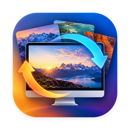

  

<h1 align="center">DynamicWall</h1>

  A fresh wallpaper on your Mac every day — from Bing, Windows Spotlight, or your own photos. 
  Free and open source. No ads, no tracking.

---

## Features

- **Daily Bing picture**, from any of 13 regions
- **Daily Windows Spotlight picture**, in 4K
- **Your own photos** as a slideshow, from any folders you choose
- **Previous / Next** to browse the last 8 days of Bing, earlier Spotlight pictures, or your slideshow
- **Gallery** of recent pictures — set or save any of them
- **Resolution options:** Automatic (fits each display, including portrait displays), Best, UHD (4K), 1920 × 1080 and 1080 × 1920
- **Every display, every Space** — and on macOS Sonoma and later, the lock screen follows your wallpaper
- **Keep a picture** for an hour, a day or a week
- Optional notifications for new pictures, auto-save to Pictures › DynamicWall, and the picture's description on the wallpaper
- **Light on battery:** wakes rarely, slows down in Low Power Mode and respects Low Data Mode
- Lives in the menu bar, with launch at login

## Screenshots

<!-- Add screenshots to the docs folder and show them here, for example:

-->

## Install

1. Download `DynamicWall.zip` from the [latest release](../../releases/latest).
2. Unzip it and drag **DynamicWall** into your **Applications** folder.
3. Open it. If macOS says it can't verify the developer, open **System Settings → Privacy & Security**, scroll down and click **Open Anyway**.
4. Click the DynamicWall icon in the menu bar to get started.

Requires macOS 14 Sonoma or later, on Apple silicon or Intel.

## Build from source

You need Xcode 15 or later.

1. Clone this repository and open `DynamicWall.xcodeproj`.
2. Choose the **DynamicWall** scheme and press **Run** (⌘R).

No Apple developer account is needed to run it on your own Mac. You can also build from Terminal with `scripts/build.sh`, which only needs the Command Line Tools.

## Privacy

DynamicWall collects no data and has no analytics. It only connects, over HTTPS, to Microsoft's Bing and Windows Spotlight servers to download pictures. Your pictures and settings stay on your Mac. It runs in Apple's App Sandbox and can only read the folders you choose for the slideshow.

## How it works

Bing pictures come from Bing's homepage picture feed, and Windows Spotlight pictures come from the same service Windows 11 uses. Both are public but undocumented, so Microsoft could change them at any time. If a source stops working, please [open an issue](../../issues).

## Support

DynamicWall is free. If you enjoy it, you can [buy me a coffee through PayPal](https://paypal.me/shantanukhedar). Thank you!

## Feedback

Found a bug or have an idea? [Open an issue](../../issues), or use **Settings › Feedback** in the app to email shanu.khedar.7@gmail.com.

## Disclaimer

DynamicWall is an independent project and is not affiliated with, endorsed by or sponsored by Microsoft. Bing and Windows Spotlight are trademarks of Microsoft. All pictures are copyright of their respective owners and are for personal desktop use; please don't redistribute them.

## License

[MIT](LICENSE) © 2026 Shantanu Khedar
